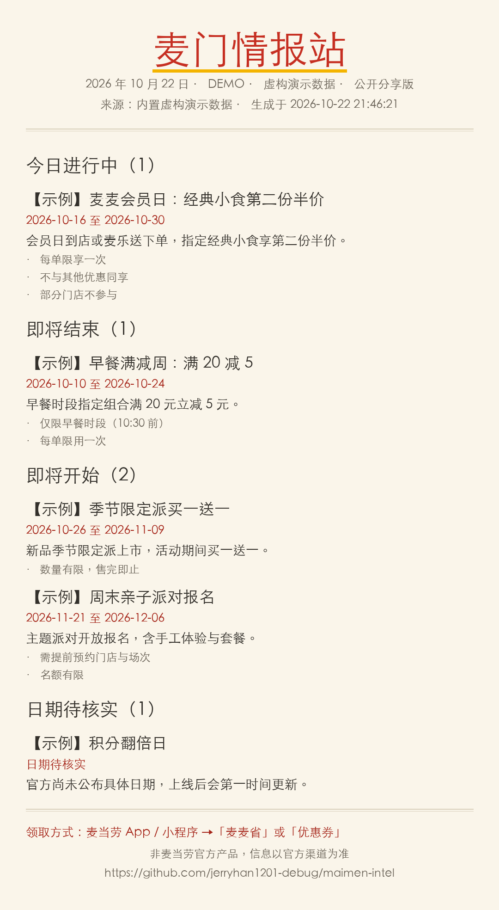

# 麦门情报站

一句话生成「当日麦当劳情报」的本地简报工具：公共活动、可领券、我的券、积分月度到期提醒，
输出私人 Markdown/HTML、公开 HTML、1080px 移动端分享 PNG 与小红书草稿。

> **本项目非麦当劳官方产品**，为麦当劳程序员节创意开发大赛参赛作品。
> 活动、价格与供应状态以麦当劳官方渠道的实时结果为准。

## 公开演示

以下示例使用**虚构数据**，不包含真实账户信息。

- [公开日报 HTML](examples/demo/report-public.html)（下载后用浏览器打开）
- [1080px 分享图](examples/demo/share-1080.png)
- [小红书文案草稿](examples/demo/xhs-draft.md)

<details>
<summary>查看分享图预览</summary>



</details>

## 目标用户

每天想知道「麦当劳今天有什么活动、有什么券能领、我的积分什么时候过期」的普通用户，
以及希望把公开活动一键生成分享图/小红书文案的内容作者。

## 安装

需要 Python 3.10+ 与 Pillow（唯一第三方依赖）：

```bash
pip install -r requirements.txt
```

## 使用

### demo：无凭证完整演示（虚构数据）

```bash
python -m maimen_intel demo
```

所有 demo 活动/券/积分均为**虚构示例**，日期相对当天真实计算（跨月/跨年正确）。

### live：真实只读查询

凭证二选一（不会打印、不会落盘原始账户响应）：

```bash
# 方式一：环境变量
export MCD_MCP_TOKEN="你的 token"        # 裸 token 或 "Bearer ..." 均可
python -m maimen_intel live

# 方式二：显式指定 WorkBuddy 配置（只读 mcpServers.mcd-mcp.headers.Authorization）
python -m maimen_intel live --workbuddy-config ~/.workbuddy/mcp.json
```

live 模式恰好执行四个只读接口：`campaign-calendar`、`available-coupons`、
`query-my-coupons`（最多 5 页、每页 200 条，如实标注分页范围）、`query-my-account`。
单接口失败不阻断日报，失败/未知会进入「数据异常」区并如实标注，绝不用 demo 顶替。

### claim：一键领券（默认关闭）

> 以下命令需在**项目根目录**（`maimen_intel/` 包所在目录）执行。

```bash
python -m maimen_intel claim            # 不带 --confirm：在任何网络调用前拒绝
python -m maimen_intel claim --confirm  # 确认后：卡包快照 → 领券 → 核验
```

claim 同样支持 `--workbuddy-config` 读取现有 WorkBuddy 凭证：

```bash
python -m maimen_intel claim --confirm --workbuddy-config ~/.workbuddy/mcp.json
```

只有显式确认才会调用 `auto-bind-coupons`；核验按券ID/券码严格比对领取前后卡包，
失败/未知一律不显示“已领取”。失败条目券名为空时显示“未命名券”，绝不回退券ID/券码；
失败理由中的券ID/券码（无论带字段名前缀还是裸值出现）一律打码。本工具不提供下单、
积分消费、抽奖等任何其他写操作。

### 常用参数

```bash
python -m maimen_intel demo --date 2026-12-15          # 指定基准日（测试跨月/跨年）
python -m maimen_intel live --max-pages 3              # 我的券分页上限（1..5，越界截断）
python -m maimen_intel demo --output-dir OUT --state-dir STATE
```

## 产物

每次运行写入 `outputs/<mode>/<日期>/`：

| 文件 | 说明 |
| --- | --- |
| `report-private.md` / `report-private.html` | 私人版：公共活动 + 可领券 + 我的券 + 积分提醒 + 数据异常 |
| `report-public.html` | 公开版：仅公共活动 + 通用领券指引 |
| `share-1080.png` | 1080px 宽分享图（仅公开内容，自动换行、动态高度） |
| `xhs-draft.md` | 小红书草稿（仅公开内容，附项目源码链接） |
| `run-status.json` | 脱敏运行状态（不含 Token、账户标识、接口原文） |

私人/公开严格隔离：公开产物在类型层面就不包含个人字段；券码/会员号等标识统一打码。
状态目录（`state/`）只保存散列键，用于“新”徽标去重（重复生成不重复标新、内容变化可识别），
demo 与 live 状态相互隔离。

## 限制

- 积分接口只提供**月度**到期汇总（`currentMouthExpirePoint`/`nextMouthExpirePoint`/
  `lastMouthExpirePoint`），无日级到期日期；缺失/非法值显示“接口未返回”，不补 0。
- 活动日期优先取券核销期；只有开始日或日期含糊的活动进入「日期待核实」，
  不会被推荐为确定进行中/即将结束。
- 「我的券」最多查询 5 页 × 200 条；页数超限时如实标注“结果不完整”。
- 不创建任何定时任务；每次手动运行生成当日简报。

## 测试

```bash
python -m unittest discover -s tests
```

## 目录结构

```
maimen_intel/        # 包：dates / parse / mcp_client / state / report / runner / claim / render
tests/               # unittest 行为测试
SKILL.md             # WorkBuddy 技能定义
MCP_INTEGRATION.md   # MCP 集成细节
mcp-config.example.json  # 配置示例（仅环境变量占位符）
CONTEST_DECLARATION.md   # 官方参赛声明（原文）
workbuddy.md         # 本机重建过程记录
```
